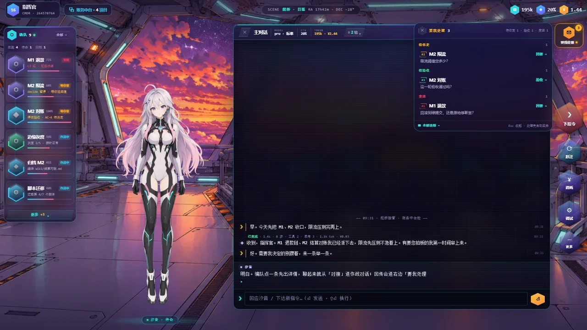
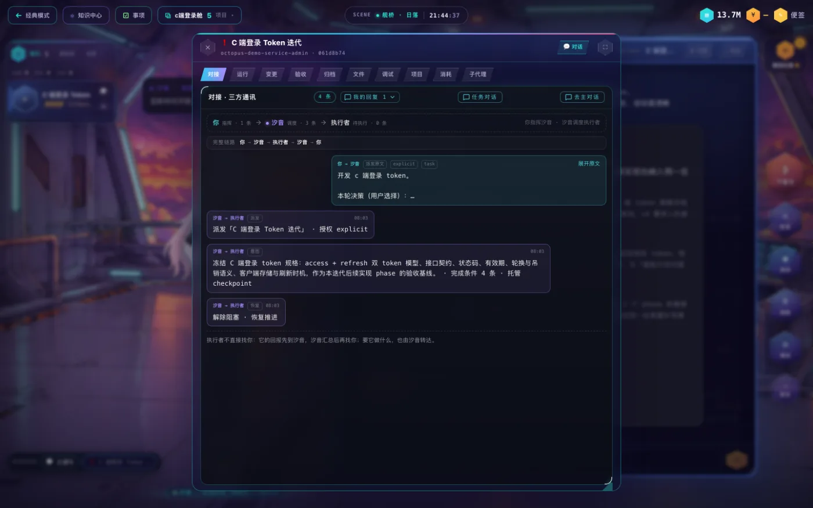
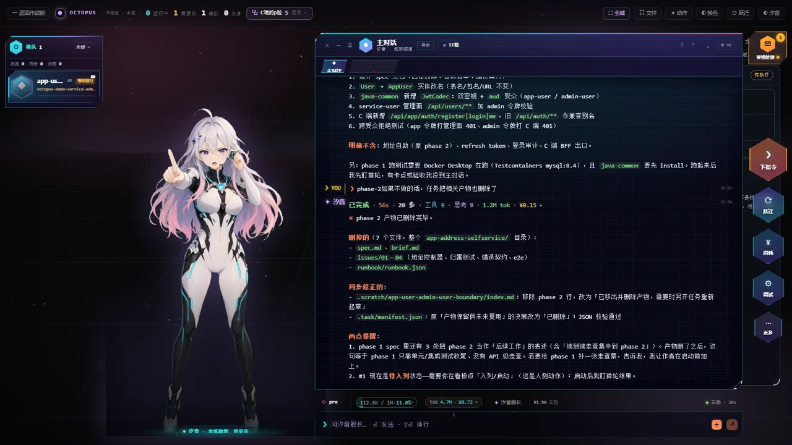
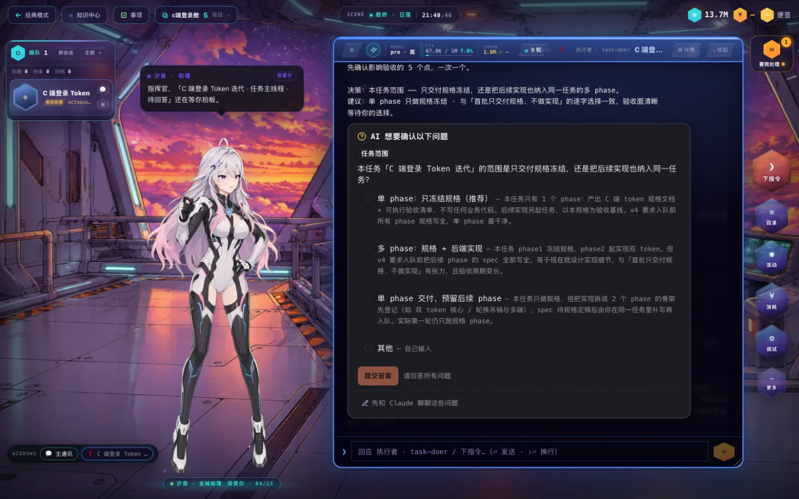

# Open Octopus

[English](README_EN.md) | **中文**

> 对话是入口，作战舱是现场，任务是一等公民。

Octopus 是一个本地优先的 AI 开发平台。你只需要把需求说出来——它自己谈规格、拆阶段、
派活、跑测试、留证据，到了该你拍板的时候才来找你。

它关心的不是「怎么编排工作流」，而是「怎么把一件事可靠地做完，并留下痕迹」。
工作流在舱底安静地转，不是你要面对的界面。



## 三件事

| | |
|---|---|
| **对话** | 桌面底层只有一个主对话。派活、问进展、做决定，都在这里。 |
| **作战舱** | 一个目录 = 一个长期舱。任务、会话、待你决定，都归它。 |
| **任务** | 从需求走到归档的唯一工作单位：规格 → 多 phase → 验收 → 归档。 |

## 一个任务的一生

```text
你说需求
   ↓
task-author 分身和你谈规格
   目标 / 验收标准 / phase 拆分 / 绑定工作流
   ↓                      ← 人拍板：入列
逐 phase 执行
   每个 phase 一轮 · 独立 worktree + 分支 · 跑测试 · 落 diff / 报告 / 证据
   ↓
待验收
   人看 1–3 条验收场景 + 机器证据，不读红绿灯流水账
   ↓                      ← 人拍板：通过
待归档
   PR / 合并 + 知识沉淀
   ↓                      ← 人说：归档
完成
```

人只出现在三处：**入列、验收、归档**。启动、重试、守护交给平台与 Agent。

失败不是「红死」状态，而是回到「待处理」：可以暂停、接管、重跑。

### 任务状态

| 状态 | 含义 |
|---|---|
| 草稿 | 还在和作者谈规格 |
| 待执行 | 已入列，等待触发 |
| 执行中 | 某个 phase 的某一轮在跑（可暂停） |
| 待验收 | 本轮到达终态，等人看证据 |
| 待归档 | 已验收，等人说「归档」 |
| 完成 | 归档结束（失败 / 中止也归入此列） |

## 待你决定

所有需要人的事收敛成一个入口：**「要我处理」**。

| 类型 | 你在决定什么 |
|---|---|
| 待你定 | Agent 在对话里提出的问题、选项 |
| 待放行 | 入列、触发、恢复 |
| 待验收 | 这轮做得对不对 |
| 受阻 | 卡住了，要不要换路或接管 |
| 待裁决 | 多方意见冲突，需要拍板 |

可以在原地选、填、提交，不必跳进任务线程。

## 三个界面

**对话桌面（默认）** —— 对话是底层，9 个应用以浮动窗口打开：今日 · 任务看板 · Agent ·
分身 · 知识中心 · 资源 · 系统调度 · 系统管理 · 设置。窗口几何、顺序、最小化状态会持久化，
深链直接打开归属窗口。

**作战舱（classic）** —— 一目录一舱。左栏是**编队**（这舱里所有作战），中间是主对话，
右栏是**要我处理**。点一条作战先看**详情**：概览 → 对接 → 运行 → 变更 → 验收 → 文件 →
调试 → 项目。



**指挥舱（全域）** —— 不绑单一目录的全局视图：所有舱的作战汇总成一支编队，同一套待办与
对话。适合一屏看全、集中拍板。



当 Agent 需要你回答时，问题会直接出现在对话里——选完就地提交：



## 引擎（内部）

工作流引擎仍然在，只是退到了任务背后：

- **11 种执行器**：bash / python / agent / condition / approval / loop / swarm / interaction /
  sub_workflow / dynamic_sub_workflow / octopus_agent
- **Swarm 5 模式**：review / debate / dispatch / swarm / moa
- **变量池**：`$vars.xxx` · `$node-id.output.xxx` · `$last_output` · `$iteration`
- **执行保障**：检查点恢复 · Token / 成本预算 · 生命周期钩子 · Harness 安全守护
- **任务绑定**：任务的每个 phase 通过 `workflow_ref` 选择一条工作流

## 资产

- **分身** —— 有长期记忆与专属 worktree 的角色（task-author / workflow-author / archive …）
- **技能** —— core-pack 内置 + 资源库安装，按任务装载
- **知识 wiki** —— `~/.octopus/knowledge/wiki` 的编译型知识库：执行前查，归档后写
- **资源** —— Skill / Agent / Workflow 的统一安装与版本管理

## 技术栈

TypeScript 5.9 · Node.js · pnpm workspaces · Hono 4（REST + SSE + WebSocket）·
Vite 8 + React 19 + React Router 7 · Electron 38 · better-sqlite3 · Monaco · XYFlow ·
Yjs · Zod · Vitest + Playwright

## 快速开始

环境：Node.js ≥ 20 · pnpm ≥ 9 · Git；执行任务时需要 Claude Code 或 Pi。

```bash
git clone git@github.com:XzhiF/open-octopus.git
cd open-octopus
pnpm install
pnpm build
pnpm dev            # UI http://localhost:3000 · API http://localhost:3001
```

桌面壳与生产模式：

```bash
pnpm desktop:dev    # Electron 桌面壳（需先 pnpm dev）
pnpm desktop:pack   # 打包 macOS arm64（未签名）
pnpm prod           # 构建产物同源托管，端口 3000
pnpm dev --isolated # worktree 隔离模式（独立端口 + 独立数据库）
pnpm dev --port 3101,3100   # 指定 web / server 端口
pnpm port           # 查看当前端口分配
```

## 项目结构

```text
octopus/
├── packages/
│   ├── shared/     ← Zod 协议 · 任务 / 舱 / 工作流 Schema · VarPool
│   ├── providers/  ← Claude SDK + Pi SDK · Token / 成本追踪
│   ├── engine/     ← 工作流引擎 · 11 执行器 · Swarm · 模拟器
│   ├── server/     ← Hono API · SSE / WS · 任务 / 舱 / 知识 / 调度服务
│   ├── web-app/    ← React SPA · 对话桌面 + 作战舱 + 指挥舱
│   ├── desktop/    ← Electron 宿主 + Node sidecar
│   ├── cli/        ← octopus CLI（内部工具）
│   └── core-pack/  ← skills / agents / clones / workflows 模板
├── scripts/        ← dev / prod / 端口分配
└── docs/           ← 设计稿 · 原型 · 研究报告
```

## 致谢

Octopus 借鉴了这些优秀项目的思路：

- **[Archon](https://github.com/coleam00/Archon)** — 工作流编排的起点。
- **[superpowers-zh](https://github.com/jnMetaCode/superpowers-zh)** — 中文技能框架。
- **[agency-agents-zh](https://github.com/jnMetaCode/agency-agents-zh)** — 中文角色库。
- **[Matt Pocock's skills](https://github.com/mattpocock/skills)** — 从需求澄清到交付的工程流程。

## 许可证

MIT License — 详见 [LICENSE](LICENSE)。
