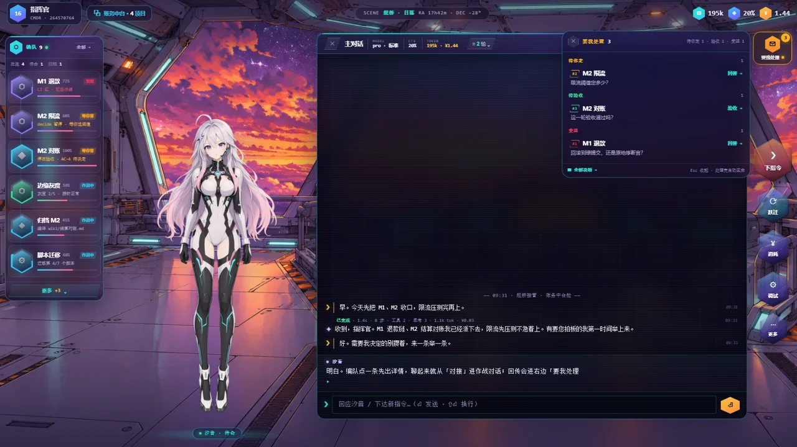
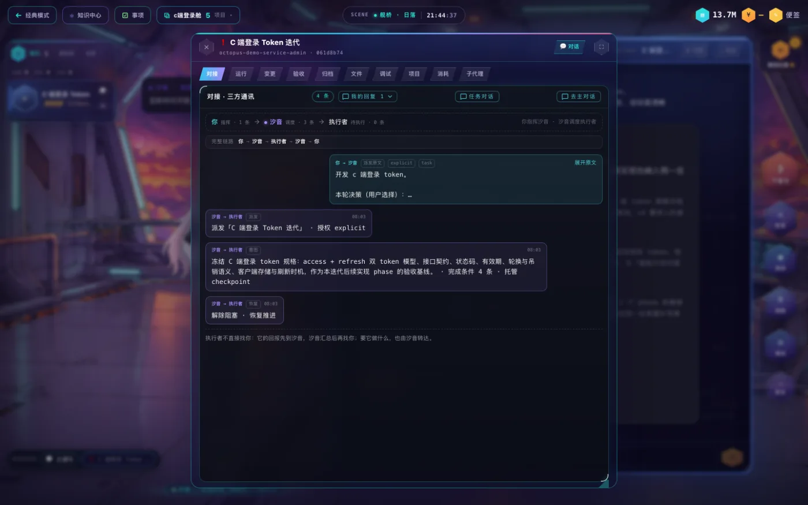
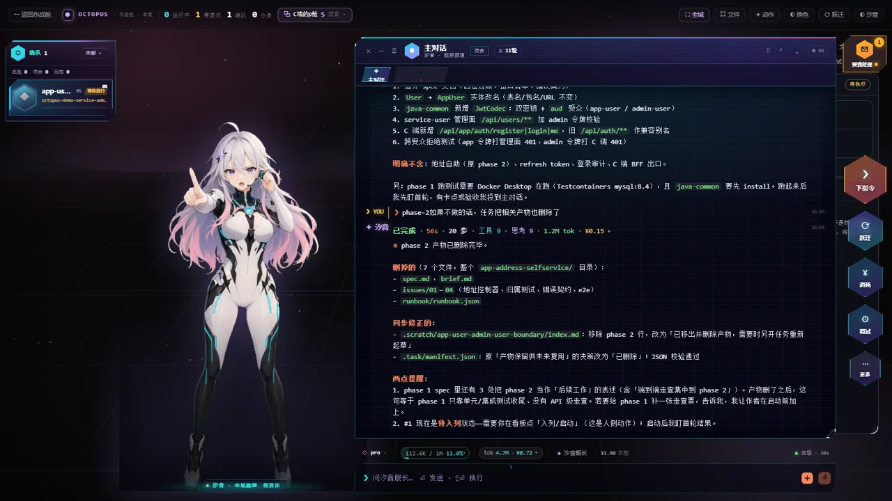
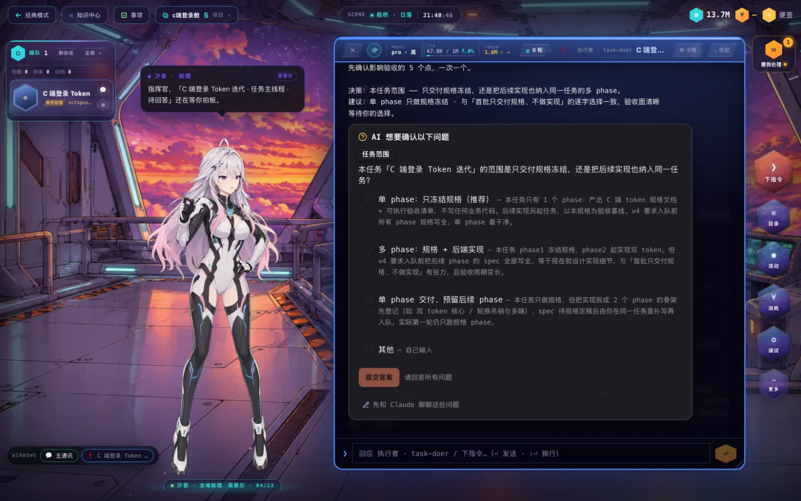
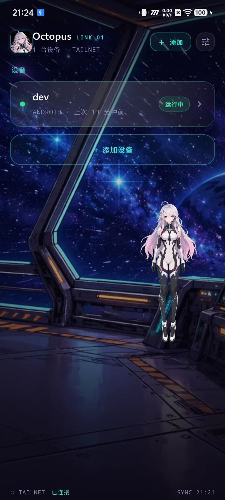
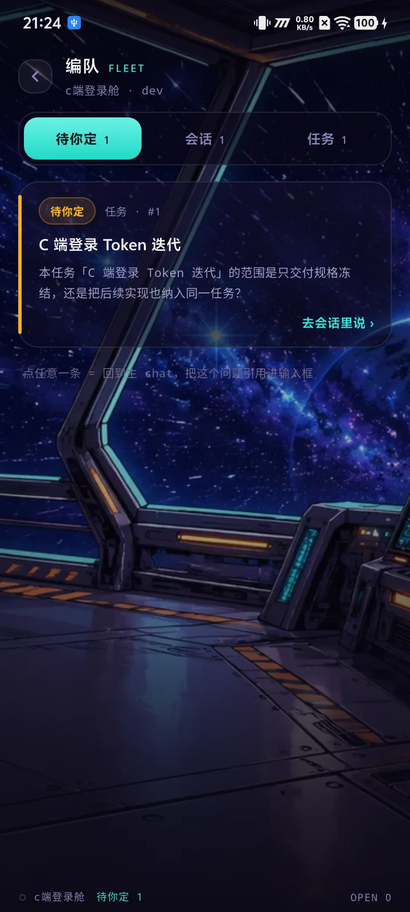
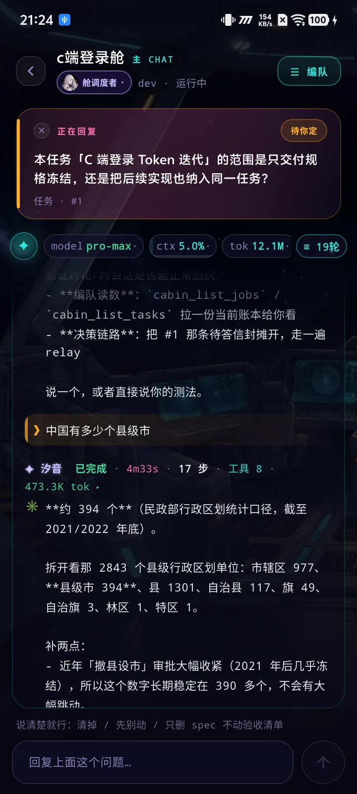
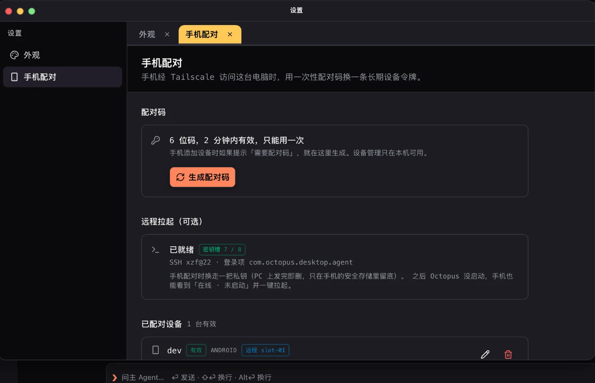

# Open Octopus

**English** | [中文](README.md)

> Chat is the entrance. The cabin is the workspace. Tasks are first-class.

Octopus is a local-first AI development platform. You describe what you want — it negotiates the
spec, splits it into phases, dispatches the work, runs the tests, keeps the evidence, and comes back
to you only when a decision is actually yours.

It is not about authoring workflows. It is about finishing a piece of work reliably and leaving a
trace behind. Workflows run quietly underneath.



## Three things

| | |
|---|---|
| **Chat** | One main conversation is the base layer. Dispatch, ask, decide — all here. |
| **Cabin** | One directory = one long-lived cabin. Tasks, sessions, and decisions live in it. |
| **Task** | The only unit of work: spec → multiple phases → acceptance → archive. |

## Life of a task

```text
You describe the need
   ↓
The task-author clone negotiates the spec with you
   goal / acceptance criteria / phase split / bound workflow
   ↓                      ← you approve: enqueue
Phase-by-phase execution
   one round per phase · its own worktree + branch · tests · diff / reports / evidence
   ↓
Awaiting review
   you read 1–3 acceptance scenarios plus machine evidence
   ↓                      ← you approve: pass
Awaiting archive
   PR / merge + knowledge ingestion
   ↓                      ← you say: archive
Done
```

You appear in exactly three places: **enqueue, review, archive**. Starting, retrying, and supervision
belong to the platform and the agents.

Failure is not a dead red state; it returns to “needs handling”. A round can be paused, taken over,
or re-run.

### Task states

| State | Meaning |
|---|---|
| Draft | Still negotiating the spec |
| Ready | Enqueued, waiting for a trigger |
| Running | A phase round is in flight (pausable) |
| Awaiting review | The round reached a terminal point; waiting for a human |
| Awaiting archive | Accepted; waiting for the human to say “archive” |
| Done | Archive finished (failed / aborted also land here) |

## Needs your attention

Everything that needs a human collapses into one inbox: **Needs handling**.

| Kind | What you decide |
|---|---|
| Ask | A question or choice raised by an agent |
| Release | Enqueue, trigger, or resume |
| Review | Whether this round is right |
| Blocked | Stuck — switch path or take over |
| Adjudicate | Conflicting opinions — make the call |

Answer in place; no need to jump into the task thread.

## Three surfaces

**Chat desktop (default)** — chat is the base layer. Nine apps open as floating windows: Today,
Task board, Agent, Clones, Knowledge, Resources, Scheduler, System, Settings. Window geometry, order,
and minimized state persist; deep links open the owning window.

**Cabin (classic)** — one directory per cabin. The left rail is the *fleet* (every operation in this
cabin), the middle is the main chat, the right is *needs handling*. Open an operation to see its
detail: Liaison → Runs → Changes → Acceptance → Archive → Files → Debug → Projects → Usage →
Sub-agents.



**Cockpit (global)** — a directory-free view: every cabin's operations in one fleet, with the same
inbox and conversation. Built for seeing everything and deciding in one place.



When an agent needs an answer, the question appears directly in the chat — pick and submit in place:



## Mobile: move the work forward while you're out

The desktop is the host and the phone is the remote: the same cabins and the same conversation, so a
reply or a decision is one tap away wherever you are.

- **It connects** — the phone reaches your machine over Tailscale and trades a one-time 6-digit code
  for a long-lived device token; the token lives only in the phone's OS secure storage, the server
  keeps just its sha256.
- **It reaches a sleeping desktop** — with remote start installed, Octopus shows up as
  “online · not running”; tap Start and you are inside within 90 seconds (the key handed to the phone
  can only run `status` / `start`).
- **Three states** — running / online · not running / offline, so “service down” and “network down”
  never look the same.
- **The same chat inside the cabin** — pending decisions, quoted replies, live run state, and
  model / ctx / tok telemetry, identical to the desktop.

<p align="center">
  
  
  
</p>

To add the phone, generate a one-time code under *Settings → Device pairing* on the desktop:



The app lives in `packages/mobile` (Flutter · Android):

```bash
cd packages/mobile
flutter build apk --release --split-per-abi
```

## Engine (internal)

The workflow engine is still here, behind the task:

- **11 executors**: bash / python / agent / condition / approval / loop / swarm / interaction /
  sub_workflow / dynamic_sub_workflow / octopus_agent
- **5 swarm modes**: review / debate / dispatch / swarm / moa
- **Variables**: `$vars.xxx` · `$node-id.output.xxx` · `$last_output` · `$iteration`
- **Execution safety**: checkpoint recovery · token / cost budgets · lifecycle hooks · Harness guard
- **Task binding**: each phase selects a workflow through `workflow_ref`

## Assets

- **Clones** — long-lived roles with memory and their own worktree (task-author / workflow-author / archive …)
- **Skills** — bundled in core-pack or installed from the resource library, loaded per task
- **Knowledge wiki** — a compiled knowledge base at `~/.octopus/knowledge/wiki`, consulted before a
  task and written after archive
- **Resources** — unified install and versioning for skills, agents, and workflows

## Tech stack

TypeScript 5.9 · Node.js · pnpm workspaces · Hono 4 (REST + SSE + WebSocket) ·
Vite 8 + React 19 + React Router 7 · Electron 38 · better-sqlite3 · Monaco · XYFlow ·
Yjs · Zod · Vitest + Playwright · Flutter 3.50 (Android phone app)

## Getting started

Requirements: Node.js ≥ 20 · pnpm ≥ 9 · Git; Claude Code or Pi for executing tasks.

```bash
git clone git@github.com:XzhiF/open-octopus.git
cd open-octopus
pnpm install
pnpm build
pnpm dev            # UI http://localhost:3000 · API http://localhost:3001
```

Desktop shell and production:

```bash
pnpm desktop:dev    # Electron shell (run pnpm dev first)
pnpm desktop:pack   # package macOS arm64 (unsigned)
pnpm prod           # serve built SPA + API on port 3000
pnpm dev --isolated # worktree isolation (own ports + database)
pnpm dev --port 3101,3100   # explicit web / server ports
pnpm port           # show port allocation
```

## Project layout

```text
octopus/
├── packages/
│   ├── shared/     ← Zod contracts · task / cabin / workflow schemas · VarPool
│   ├── providers/  ← Claude SDK + Pi SDK · token / cost tracking
│   ├── engine/     ← workflow engine · 11 executors · swarm · simulator
│   ├── server/     ← Hono API · SSE / WS · task / cabin / knowledge / scheduler services
│   ├── web-app/    ← React SPA · chat desktop + cabin + cockpit
│   ├── desktop/    ← Electron host + Node sidecar
│   ├── mobile/     ← Flutter phone app · devices / cabins / chat interior
│   ├── cli/        ← octopus CLI (internal tool)
│   └── core-pack/  ← skills / agents / clones / workflow templates
├── scripts/        ← dev / prod / port allocation
└── docs/           ← design notes · prototypes · research
```

## Acknowledgements

- **[Archon](https://github.com/coleam00/Archon)** — the starting point for workflow orchestration.
- **[superpowers-zh](https://github.com/jnMetaCode/superpowers-zh)** — Chinese skill framework.
- **[agency-agents-zh](https://github.com/jnMetaCode/agency-agents-zh)** — Chinese role library.
- **[Matt Pocock's skills](https://github.com/mattpocock/skills)** — the clarify → spec → deliver flow.

## License

MIT License — see [LICENSE](LICENSE).
